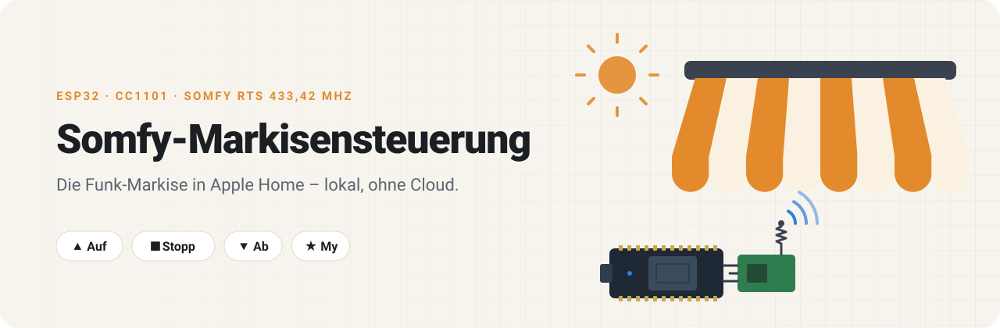

<p align="center">
  <picture>
    <source media="(prefers-color-scheme: dark)" srcset="docs/images/hero-dark.svg">
    <source media="(prefers-color-scheme: light)" srcset="docs/images/hero-light.svg">
    
  </picture>
</p>

<p align="center">
  
  <a href="https://github.com/rstrouse/ESPSomfy-RTS"></a>
  
  
  
  <a href="LICENSE"></a>
</p>

Eine Somfy-Funkmarkise (RTS) wird mit einem ESP32 und einem CC1101-Funkmodul für rund 15 € smart und lässt sich in **Apple Home** auf- und einfahren, stoppen und auf die **My-Position** fahren. Der ESP32 meldet sich an der Markise als zusätzliche Fernbedienung an, die Original-Fernbedienung funktioniert weiterhin.

<!-- TODO: Foto bzw. Rendering des Geräts im Gehäuse, sobald vorhanden:
<p align="center"></p>
-->

## So funktioniert es

<p align="center">
  
</p>

Die Home-App spricht über das Apple TV mit Homebridge auf dem Raspberry Pi. Homebridge schickt Befehle per HTTP an den ESP32, der sie als Somfy-RTS-Funktelegramm mit korrektem Rolling Code an den Markisenmotor sendet. Drückt jemand die Original-Fernbedienung, hört der ESP32 mit und hält die Position aktuell. Alles bleibt lokal im Heimnetz – keine Cloud, kein MQTT, kein Somfy-Konto.

## Features

- **Auf, Ab, Stopp, My** – alle Tasten der Telis 1 RTS, dazu Positionen in Prozent
- **Rolling Code** korrekt umgesetzt, der ESP32 ist eine vollwertige virtuelle Fernbedienung
- **Original-Fernbedienung bleibt nutzbar**, ESPSomfy-RTS hört mit und hält die Position aktuell
- **Weboberfläche** im lokalen Netz, kein Cloud-Konto, kein MQTT nötig
- **Apple Home** über die vorhandene Homebridge (Raspberry Pi) und das Apple TV als Steuerzentrale
- **3D-druckbares Gehäuse** mit USB-Aussparung und freiem Funkweg für die Antenne

## Hardware

| Bauteil | Details | Status |
| --- | --- | --- |
| Mikrocontroller | ESP32-DevKit, ESP32-WROOM-32, 38 Pins, Micro-USB | vorhanden |
| Funkmodul | CC1101, 433-MHz-Variante mit Antenne, 2,54-mm-Raster | zu kaufen |
| Stromversorgung | USB-Netzteil (5 V, ≥ 1 A) und Micro-USB-Kabel | zu kaufen |
| Aufbau | 1 Breadboard (830 Kontakte), 10 Dupont-Kabel | vorhanden |
| Optional | 0,96″-I²C-OLED (SSD1306), reserviert: IO27 (SDA) / IO14 (SCL) | offen |
| Markise | Somfy RTS, Fernbedienung Telis 1 RTS Pure, 433,42 MHz | vorhanden |
| **Summe** | ohne vorhandene Teile ca. 10–15 € | |

> [!IMPORTANT]
> Einfache 433,92-MHz-Module (z. B. RWS-371, WS433) funktionieren **nicht**. Somfy RTS sendet auf 433,42 MHz und braucht einen frei abstimmbaren Transceiver wie den CC1101.

## Verdrahtung

<table>
  <tr>
    <td width="50%"></td>
    <td width="50%"></td>
  </tr>
  <tr>
    <td align="center"><b>Schaltplan</b></td>
    <td align="center"><b>Breadboard-Aufbau</b> · <a href="docs/aufbau.md">Schritt für Schritt</a></td>
  </tr>
</table>

<p align="center">
  
</p>

| CC1101 | ESP32 | Funktion |
| --- | --- | --- |
| VCC | 3V3 | Versorgung, **nur 3,3 V** |
| GND | GND | Masse |
| GDO2 | IO34 | Empfangen (*RX Pin*) – nötig zum Mithören der Telis |
| MISO | IO35 | SPI-Daten zum ESP32 |
| MOSI | IO32 | SPI-Daten zum CC1101 |
| SCK | IO33 | SPI-Takt |
| CSN | IO25 | SPI-Chip-Select |
| GDO0 | IO26 | Senden (*TX Pin*) |

Alle Leitungen liegen an der **linken Pinreihe** des DevKits. So passt der Aufbau auf **ein** Breadboard: Das 38-Pin-DevKit ist so breit, dass nur auf einer Seite eine Lochreihe frei bleibt. Der ESP32 leitet SPI über seine GPIO-Matrix auf beliebige Pins, ESPSomfy-RTS übernimmt die Pins aus den Einstellungen.

> [!WARNING]
> Den CC1101 niemals an 5 V anschließen. Die Pinreihenfolge auf der Stiftleiste unterscheidet sich je nach Modul – immer nach dem Aufdruck verdrahten, nicht nach der Position.

## Schnellstart

1. **Kompilieren und flashen mit der Arduino IDE** – ESP32-Core 2.0.17, vier Bibliotheken, Sketch hochladen, Weboberfläche per LittleFS-Upload. → [firmware/](firmware/README.md)
2. **CC1101 konfigurieren** – Pins wie oben eintragen, Frequenz **433,42 MHz**, Radio aktivieren. → [firmware/](firmware/README.md#cc1101-konfigurieren)
3. **Als Fernbedienung anlernen** – PROG an der Telis drücken, dann im Web-UI *Pair Shade*. → [docs/anlernen.md](docs/anlernen.md)
4. **In Apple Home einbinden** – über Homebridge. → [docs/homekit.md](docs/homekit.md)

## Dokumentation

| | Thema |
| --- | --- |
| 🔧 | [Aufbau auf dem Breadboard](docs/aufbau.md) – Stückliste, Schaltplan, Schritte, Fehlersuche |
| 💾 | [Firmware](firmware/README.md) – Arduino IDE, Bibliotheken, Flashen, CC1101 konfigurieren, Backups |
| 📡 | [Anlernen](docs/anlernen.md) – ESP32 als Fernbedienung anmelden, Testprotokoll, Reichweite |
| 🏠 | [Apple Home](docs/homekit.md) – Homebridge-Anbindung, API, Optionen |
| 📦 | [Gehäuse](enclosure/README.md) – Anforderungen an den 3D-Druck |
| 📝 | [Projektbriefing](docs/projektbriefing.md) – Ausgangslage und Ziele |

## Projektstand

- [ ] Phase 1 – ESPSomfy-RTS flashen, CC1101 konfigurieren
- [ ] Phase 2 – ESP32 an der Markise anlernen
- [ ] Phase 3 – Auf, Ab, Stopp, My testen, Reichweite prüfen
- [ ] Phase 4 – Homebridge- bzw. HomeKit-Anbindung
- [ ] Phase 5 – Gehäuse (3D-Druck)

## Repository

```
firmware/    Arduino-IDE-Anleitung, Konfiguration und Backups von ESPSomfy-RTS
enclosure/   Gehäuse: STL-Dateien (stl/) und Quelldateien (source/)
docs/        Anleitungen, Schaltplan, Bilder
  images/    SVG-Grafiken, erzeugt mit generate.py
```

Alle Grafiken sind Vektor-SVGs und passen sich dem hellen bzw. dunklen GitHub-Design an. Nach Änderungen neu erzeugen mit `python3 docs/images/generate.py docs/images`.

## Credits

Die eigentliche Arbeit steckt in [**ESPSomfy-RTS**](https://github.com/rstrouse/ESPSomfy-RTS) von Robert Strouse: Funkprotokoll, Rolling-Code-Verwaltung, Weboberfläche und Positionsverfolgung. Weiterentwickelt wird es im Fork von [**cjkas**](https://github.com/cjkas/ESPSomfy-RTS), der allerdings PlatformIO statt der Arduino IDE voraussetzt. Dieses Repo dokumentiert den konkreten Aufbau für eine Somfy-Markise und die Anbindung an Apple Home.

## Lizenz

Dokumentation, Grafiken und Gehäusedateien dieses Repos stehen unter der [MIT-Lizenz](LICENSE). ESPSomfy-RTS selbst steht unter [The Unlicense](https://github.com/rstrouse/ESPSomfy-RTS/blob/main/LICENSE) (gemeinfrei) und wird hier nicht mitgeliefert, sondern aus dem Original-Repository kompiliert.

Somfy, RTS und Telis sind Marken der Somfy SAS. Dieses Projekt steht in keiner Verbindung zu Somfy.
