# Aufbau auf dem Breadboard

Schritt-für-Schritt-Anleitung für den Testaufbau aus ESP32-DevKit und CC1101. Gelötet wird nichts.

  

## Stückliste

| Anzahl | Bauteil | Hinweis |
| --- | --- | --- |
| 1 | ESP32-DevKit, ESP32-WROOM-32, 38 Pins | Stiftleisten verlötet |
| 1 | CC1101-Modul **433 MHz** mit Antenne, 2,54-mm-Raster | Keine 868-MHz-Variante – die sieht gleich aus |
| 2 | Breadboard (830 Kontakte) | Das DevKit ist zu breit für eines |
| 10 | Dupont-Kabel | 8 zum CC1101, 2 Brücken für 3V3/GND auf die Schiene |
| 1 | USB-Netzteil 5 V/1 A und Micro-USB-Kabel | Datenkabel, kein reines Ladekabel |

## Schaltplan

  

## Schritte

1. **Breadboards ausrichten:** Zwei Breadboards dicht nebeneinander legen, Plus-Schienen jeweils außen.
2. **ESP32 einstecken:** Das DevKit so über die Fuge setzen, dass die linke Pinreihe in der letzten Spalte (j) von Board A und die rechte Pinreihe in der ersten Spalte (a) von Board B steckt. So bleiben auf beiden Seiten vier freie Kontakte pro Pin. Antenne des ESP32 nach oben, USB nach unten.
3. **Versorgung auf die Schiene:** 3V3 (Board A, Reihe 3) mit einer Brücke auf die rechte **+**-Schiene von Board B legen, GND (Board B, Reihe 3) auf die **−**-Schiene daneben.
4. **CC1101 versorgen:** VCC an die **+**-Schiene, GND an die **−**-Schiene. **Niemals an 5 V oder VIN.**
5. **SPI verbinden:** SCK → IO18, MISO → IO19, MOSI → IO23, CSN → IO5.
6. **Funkleitungen:** GDO0 → IO26 (Senden), GDO2 → IO17 (Empfangen).
7. **Kontrolle vor dem Einschalten:** Jede Leitung mit der Tabelle unten abhaken, besonders VCC und die Pinreihenfolge auf dem CC1101-Aufdruck.
8. **USB anschließen** und mit dem [Flashen](../firmware/README.md) weitermachen.

## Verbindungstabelle

| # | Farbe (Vorschlag) | CC1101 | ESP32 | Board / Reihe |
| --- | --- | --- | --- | --- |
| 1 | rot | VCC | 3V3 | über +-Schiene B |
| 2 | schwarz | GND | GND | über −-Schiene B |
| 3 | grün | SCK | IO18 | B / 11 |
| 4 | lila | MISO | IO19 | B / 10 |
| 5 | blau | MOSI | IO23 | B / 4 |
| 6 | gelb | CSN | IO5 | B / 12 |
| 7 | orange | GDO0 | IO26 | A / 12 |
| 8 | grau | GDO2 | IO17 | B / 13 |

Reihenangaben gelten, wenn Pin 1 des DevKits (3V3 bzw. GND) in Reihe 3 steckt.

## Fehlersuche

| Symptom | Ursache und Lösung |
| --- | --- |
| Kein serieller Port am Mac | Ladekabel ohne Datenleitungen oder fehlender CP210x/CH340-Treiber |
| ESPSomfy-RTS meldet keinen CC1101 | MISO/MOSI vertauscht, CSN falsch, Modul nicht an 3,3 V |
| Telis-Befehle erscheinen nicht im Log | GDO2 nicht verbunden, falsche Frequenz (433,42 MHz) oder RX-Pin falsch eingetragen |
| Markise reagiert nur aus der Nähe | Antenne abgeschirmt oder liegend; Sendeleistung erhöhen |
| ESP32 startet neu, sobald gesendet wird | schwaches Netzteil oder langes, dünnes USB-Kabel |
