# Aufbau auf dem Breadboard

Schritt-für-Schritt-Anleitung für den Testaufbau aus ESP32-DevKit und CC1101. Gelötet wird nichts.

  

## Stückliste

| Anzahl | Bauteil | Hinweis |
| --- | --- | --- |
| 1 | ESP32-DevKit, ESP32-WROOM-32, 38 Pins | Stiftleisten verlötet |
| 1 | CC1101-Modul **433 MHz** mit Antenne, 2,54-mm-Raster | Keine 868-MHz-Variante – die sieht gleich aus |
| 1 | Breadboard (830 Kontakte) | Eine Lochreihe neben dem DevKit bleibt frei – das reicht |
| 8 | Dupont-Kabel Stecker–Buchse | vom Breadboard zu den Stiften des CC1101 |
| 2 | Dupont-Kabel Stecker–Stecker | Brücken für 3V3/GND auf die Schiene |
| 1 | USB-Netzteil 5 V/1 A und Micro-USB-Kabel | Datenkabel, kein reines Ladekabel |

## Schaltplan

  

## Schritte

1. **ESP32 einstecken:** Die linke Pinreihe des DevKits in **Spalte b**, die rechte in **Spalte j**, Pin 1 (3V3) in **Reihe 3**. Antenne nach oben, USB nach unten. Das DevKit ist 25,4 mm breit und überdeckt damit die Spalten c bis i. Frei bleibt nur **Spalte a**, und genau dort liegen alle Anschlüsse.
2. **Versorgung auf die Schiene:** Brücke von **a3** (3V3) auf die linke **+**-Schiene, Brücke von **a16** (GND) auf die linke **−**-Schiene.
3. **CC1101 versorgen:** VCC an die **+**-Schiene, GND an die **−**-Schiene. **Niemals an 5 V oder VIN.**
4. **SPI verbinden:** MISO → a8 (IO35), MOSI → a9 (IO32), SCK → a10 (IO33), CSN → a11 (IO25).
5. **Funkleitungen:** GDO2 → a7 (IO34, Empfangen), GDO0 → a12 (IO26, Senden).
6. **CC1101 links neben das Breadboard legen.** Die Kabel laufen dann parallel und kreuzen sich nicht.
7. **Kontrolle vor dem Einschalten:** Jede Leitung mit der Tabelle unten abhaken, besonders VCC und die Pinreihenfolge auf dem CC1101-Aufdruck.
8. **USB anschließen** und mit dem [Flashen](../firmware/README.md) weitermachen.

## Verbindungstabelle

| # | Farbe (Vorschlag) | CC1101 | ESP32 | Board / Reihe |
| --- | --- | --- | --- | --- |
| 1 | rot | VCC | 3V3 | a3 → +-Schiene |
| 2 | schwarz | GND | GND | a16 → −-Schiene |
| 3 | grau | GDO2 | IO34 | a7 |
| 4 | lila | MISO | IO35 | a8 |
| 5 | blau | MOSI | IO32 | a9 |
| 6 | grün | SCK | IO33 | a10 |
| 7 | gelb | CSN | IO25 | a11 |
| 8 | orange | GDO0 | IO26 | a12 |

Die Lochangaben gelten, wenn Pin 1 des DevKits (3V3) in Reihe 3 steckt.

> [!NOTE]
> Die Pins weichen bewusst von den SPI-Standardpins (IO18/19/23/5) ab, denn die liegen auf der rechten, verdeckten Pinreihe. Der ESP32 leitet SPI über die GPIO-Matrix auf beliebige Pins. IO34 und IO35 können nur Eingänge sein und passen deshalb genau für MISO und RX. Die Pins werden in ESPSomfy-RTS eingetragen, siehe [Firmware](../firmware/README.md#cc1101-konfigurieren).

## Fehlersuche

| Symptom | Ursache und Lösung |
| --- | --- |
| Kein serieller Port am Mac | Ladekabel ohne Datenleitungen oder fehlender CP210x/CH340-Treiber |
| ESPSomfy-RTS meldet keinen CC1101 | MISO/MOSI vertauscht, Pins im Web-UI nicht auf 33/35/32/25 gestellt, Modul nicht an 3,3 V |
| Telis-Befehle erscheinen nicht im Log | GDO2 nicht an IO34, falsche Frequenz (433,42 MHz) oder RX-Pin falsch eingetragen |
| Markise reagiert nur aus der Nähe | Antenne abgeschirmt oder liegend; Sendeleistung erhöhen |
| ESP32 startet neu, sobald gesendet wird | schwaches Netzteil oder langes, dünnes USB-Kabel |
