# ESP32 Somfy-Markisensteuerung (RTS)

Projektbriefing als Startpunkt für Claude Code und das GitHub-Repo. Separates Projekt, unabhängig von der Heizungssteuerung.

## Ziel

Die funkgesteuerte Somfy-Markise per ESP32 smart machen und in Apple Home steuern (auf, ab, stopp, My-Position).

## Bestehendes System

- Fernbedienung: Somfy Telis 1 RTS Pure
- Protokoll: Somfy RTS, 433,42 MHz, Rolling Code
- Hinweis: Einfache 433,92-MHz-Module (vorhanden: RWS-371 Empfänger, WS433 Sender) sind für RTS ungeeignet

## Hardware

- Mikrocontroller: ESP32-DevKit (ESP32-WROOM-32, 38 Pins, Stiftleisten bereits verlötet, Micro-USB)
- Funkmodul: CC1101, 433-MHz-Variante, 2,54-mm-Raster (muss noch gekauft werden)
- Optional: Display (z. B. 0,96" I²C-OLED an G21/G22)
- Stromversorgung: USB-Netzteil
- Aufbau: Breadboard und Dupont-Kabel

## Verdrahtung (ESP32-DevKit)

| Funktion | ESP32-Pin |
| --- | --- |
| CC1101 SCK | IO18 |
| CC1101 MISO | IO19 |
| CC1101 MOSI | IO23 |
| CC1101 CSN | IO5 |
| CC1101 GDO0 | IO26 |
| CC1101 GDO2 | IO17 (optional) |
| CC1101 VCC / GND | 3,3 V / GND |

Breadboard-Tipp: Das DevKit ist breit, daher zwei Breadboards nebeneinander nutzen. 3V3 und GND auf die Versorgungsschienen legen. Den CC1101 niemals an 5 V anschließen.

Auf dem Breadboard: ESP32 mittig über zwei Boards, CC1101 daneben, acht Dupont-Kabel genau wie gezeichnet.

## Software

- Basis: Open-Source-Projekt ESPSomfy-RTS (ESP32 + CC1101), bringt Weboberfläche, Rolling-Code-Verwaltung und das Anlernen als zusätzliche Fernbedienung mit
- Smart-Home-Anbindung ohne MQTT, idealerweise über ein Homebridge-Plugin für ESPSomfy-RTS (Verfügbarkeit prüfen) oder alternativ direkt per HomeKit
- Vorhandenes Setup: Homebridge auf Raspberry Pi, Apple TV als Home-Zentrale, Steuerung über Apple Home

## Phasen

1. ESPSomfy-RTS flashen, CC1101 konfigurieren
2. ESP32 an der Markise als neue Fernbedienung anlernen (die Originalfernbedienung bleibt nutzbar)
3. Auf, ab, stopp und My-Position testen, Reichweite prüfen
4. Homebridge- bzw. HomeKit-Anbindung
5. Gehäuse: 3D-Druck, Aussparung für USB, ggf. Display, Antenne nicht durch Metall abschirmen

## Einkaufsliste

- 1x CC1101-Modul 433 MHz mit Antenne, 2,54-mm-Raster
- USB-Netzteil und Kabel

## Offene Punkte

- Mit oder ohne Display
- Homebridge-Plugin oder HomeKit direkt
- Montageort und Reichweite zur Markise

## GitHub-Repo

Das Repo wird öffentlich und soll sich optisch von üblichen Bastel-Repos abheben.

- Hero-Banner oben im README (SVG, hell und dunkel per `<picture>`), mit Projektname, Kurzclaim und stilisierter Zeichnung von Markise, ESP32 und Funkwellen
- Badges: Plattform ESP32, Basis ESPSomfy-RTS, Lizenz, HomeKit
- Kurzer Pitch in zwei Sätzen, danach Foto oder Rendering des Geräts im Gehäuse
- Feature-Liste, Hardware-Tabelle, Verdrahtungsplan als SVG
- Schnellstart: Flashen, CC1101 konfigurieren, als Fernbedienung anlernen, in Apple Home einbinden
- Credits an ESPSomfy-RTS
- Ordner: `firmware/`, `enclosure/` (STL und Quelldateien), `docs/` (Schaltplan, Bilder)
- Lizenz passend zu ESPSomfy-RTS prüfen
